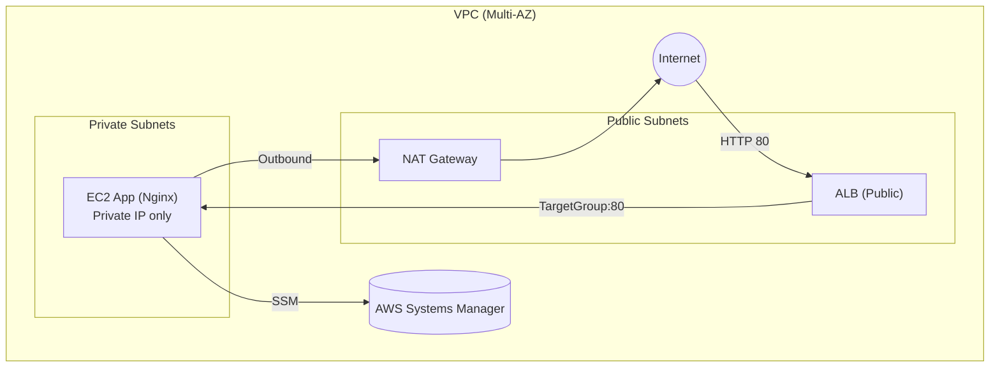
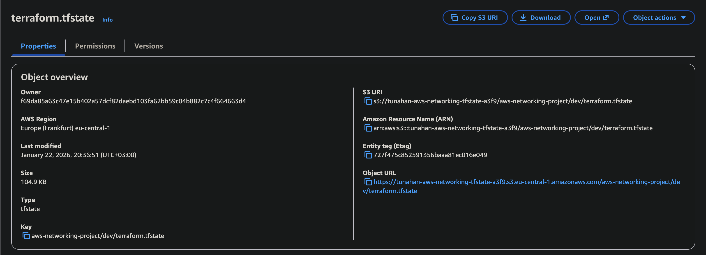
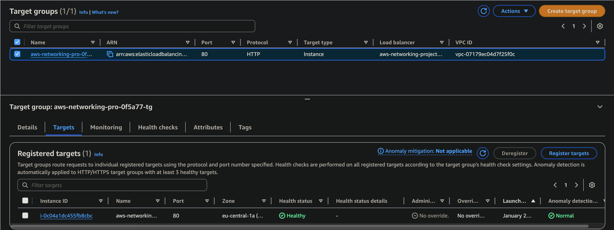

# AWS Networking Project (Terraform)
> Production-ready VPC architecture with ALB, Private EC2, and Zero-Trust access.

## 🎯 Objective
This project demonstrates a secure, modular AWS networking foundation using Terraform. It focuses on the **Zero-Trust** model by eliminating SSH access and managing private workloads via AWS Systems Manager (SSM). This setup is designed to reflect real-world production constraints, specifically addressing the nuances of stateless network controls and secure egress.

## 🚀 Key Features
- **Multi-AZ VPC:** High availability across multiple Availability Zones.
- **Secure Egress:** Private instances reach the internet via NAT Gateways for updates without being exposed.
- **SSM-Only Management:** No public SSH ports (Port 22 closed); secure shell access through SSM Session Manager.
- **Remote State with Locking:** S3 backend with DynamoDB locking for safe, collaborative infrastructure management.
- **Security Hardening:** IMDSv2 enabled, EBS encryption enforced, and perimeter-less management.

## 🏗️ Architecture

> Note: This architecture uses SSM without VPC endpoints; the private instance reaches SSM over the internet via NAT (outbound-only).

---

## 🔐 Security Model & NACL Nuances
### Security Groups (Stateful)
- **ALB SG:** Inbound `80/tcp` from `0.0.0.0/0`. Outbound to App SG on port 80.
- **App SG:** Inbound port 80 **only from ALB SG**. Outbound allowed for SSM agent and package repositories.

### NACLs (Stateless) — The "Return Traffic" Challenge
Because NACLs are **stateless**, we explicitly handle **ephemeral return traffic**. A common mistake in such architectures is allowing outbound traffic but having replies dropped by the NACL.
- **Public NACL:** Allows `80,443` from internet + ephemeral `1024-65535` for return traffic.
- **Private NACL:** 
  - **Inbound:** Allows `app_port` from VPC CIDR and **ephemeral (1024-65535) from 0.0.0.0/0** to permit NAT return traffic.
  - **Outbound:** Allows `80/443` to internet (via NAT) and DNS (`53/udp,tcp`) to the VPC resolver.

---

## 💾 Remote State + Locking
Backend configuration ensures safe collaboration using an S3 bucket for state storage and a DynamoDB table for locking.



Terraform backend stanza:
```hcl
terraform {
  backend "s3" {}
}
```

---

## 🛠️ Tech Stack
- **Cloud:** AWS (VPC, ALB, EC2, SSM, S3, DynamoDB)
- **IaC:** Terraform (Modules, Remote Backends)
- **CI/CD:** GitHub Actions (Linting, Validation, Planning)
- **Security:** tfsec (Static Analysis)

## 🩺 Debug Story (Real-world Issues & Fixes)
Showcasing the troubleshooting depth of this project:

1.  **ALB 502 / Health Check Failures:** Fixed by ensuring Target Group ports strictly match the application port and handling AWS name length constraints.
2.  **SSM Reachability:** Resolved "SSM Agent unable to acquire credentials" by correctly configuring **stateless NACL ephemeral rules** to allow NAT return traffic (source = public IPs).
3.  **DNS Timeouts:** Implemented explicit DNS egress rules in the private NACL to reach the VPC resolver (`VPC_CIDR + .2`).

## 🛡️ Security Scan
Terraform security scanning executed with **tfsec**:
- **Critical:** 0
- **High:** 0
- **Medium:** 0
- **Passed:** 28

---

## 🔧 Setup & Usage
1. **Initialize:** `terraform init -backend-config=backend.hcl`
2. **Plan:** `terraform plan`
3. **Apply:** `terraform apply`

## ✅ Verification
- Access the application via the ALB DNS name.
- Verify "Healthy" status in the AWS Target Group console.



- Test shell access via `aws ssm start-session --target <instance_id>`.

## 🧹 Cleanup
```bash
terraform destroy
```

---
Created by **Tunahan Koç** | [LinkedIn](https://www.linkedin.com/in/tunahan-koc-8b43b765/) | [GitHub](https://github.com/tnhkoc)
