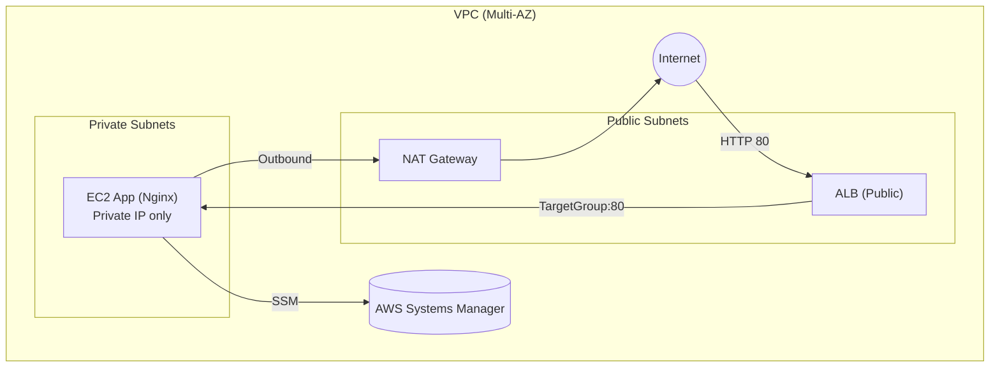

# AWS Networking Project (Terraform)
> Production-ready VPC architecture with ALB, Private EC2, and Zero-Trust access.

## 🎯 Objective
This project demonstrates a secure, modular AWS networking foundation using Terraform. It focuses on the **Zero-Trust** model by eliminating SSH access and managing private workloads via AWS Systems Manager (SSM).

## 🚀 Key Features
- **Multi-AZ VPC:** High availability across two Availability Zones.
- **Secure Egress:** Private instances reach the internet via NAT Gateways for updates.
- **SSM-Only Management:** No public SSH ports; secure shell access through SSM Session Manager.
- **Stateless NACL Orchestration:** Explicit handling of return traffic for NAT-originating flows.
- **State Management:** S3 backend with DynamoDB locking for team collaboration.

## 🏗️ Architecture


## 🛠️ Tech Stack
- **Cloud:** AWS (VPC, ALB, EC2, SSM, S3, DynamoDB)
- **IaC:** Terraform (Modules, Remote Backends)
- **CI/CD:** GitHub Actions (Linting, Validation)

## 🔧 Setup & Usage
1. Initialize the backend: `terraform init -backend-config=backend.hcl`
2. Review the plan: `terraform plan`
3. Apply changes: `terraform apply`

## ✅ Verification
- Access the application via the ALB DNS name.
- Verify "Healthy" status in the AWS Target Group console.
- Test shell access via `aws ssm start-session --target <instance_id>`.

## 🧹 Cleanup
To avoid ongoing AWS costs:
```bash
terraform destroy
```

---
Created by **Tunahan Koç** | [LinkedIn](https://www.linkedin.com/in/tunahan-koc-8b43b765/) | [GitHub](https://github.com/tnhkoc)
